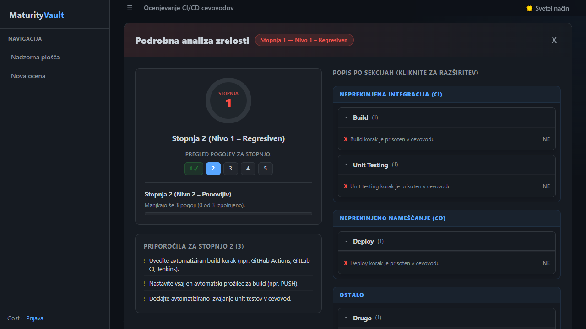

# ZK 5 · Avtomatizirano funkcionalno testiranje

Individualna izvedba pokriva tri scenarije iz 3. naloge. Testi v brskalniku odprejo Reactov vmesnik, izvedejo uporabniške korake in preverijo odzive C++ REST API, ki podatke bere iz PostgreSQL. Stopnjo zrelosti v teh scenarijih izračuna Reactova aplikacija v brskalniku iz pravil, ki jih je prejela prek API-ja. [Ročna specifikacija TS-01–TS-03](docs/FUNKCIONALNO_TESTIRANJE_ISO29119-3.md#4-seznam-scenarijev-in-odgovornosti)

## Izbira orodja

| Orodje | Primernost za projekt |
| --- | --- |
| **Playwright Test** | Uporablja pravi brskalnik, podpira čiste brskalniške kontekste za gosta, člana in administratorja, čakanje na konkretne HTTP odgovore ter vgrajena HTML, JUnit in JSON poročila. Ob padcu shrani posnetek zaslona in sled dejanj. C++ in PostgreSQL sta dostopna prek istih HTTP poti kot pri običajni uporabi. |
| **Cypress** | Prav tako podpira brskalniške funkcionalne teste in spremljanje HTTP zahtevkov. Playwright sem izbral zaradi preprostega preizkusa dveh ločenih sej v TS-01, samodejnega zagona Vite in vgrajene pregledne sledi za analizo padca. |

[Playwrightova dokumentacija za CI](https://playwright.dev/docs/ci) · [Zagon lokalnega strežnika](https://playwright.dev/docs/test-webserver) · [Cypressovi podprti brskalniki](https://docs.cypress.io/app/references/launching-browsers)

## Namestitev in lokalni zagon

Potrebujete Node.js 22.12 ali novejši iz veje 22, npm, Docker Compose V2 z Linux vsebniki in prosti vrati 4173 ter 18083. Prva namestitev prenese pakete, Chromium in odvisnosti za C++ gradnjo.

```powershell
npm ci
npx playwright install chromium
docker compose -f tests/e2e/compose.yml up --build --wait --wait-timeout 120
npm run test:e2e
docker compose -f tests/e2e/compose.yml down
```

Compose zažene C++ API in namensko PostgreSQL bazo v pomnilniku. `vprasalnik.sql` pripravi shemo in lokalni testni admin račun. Backend uvozi privzeta vprašalnika in pravila. Testi ustvarijo enolične sintetične članske račune in jih po uporabi izbrišejo. Ustavitev namenskega Compose okolja odstrani njegove začasne podatke.

- Samo TS-03 zaženete z `npm run test:e2e -- --grep TS-03`.
- HTML poročilo odprete z `npx playwright show-report artifacts/e2e/html`.
- Če imate sistemski Chrome, lahko v PowerShellu nastavite `$env:E2E_BROWSER_CHANNEL = 'chrome'`. Playwright ga zažene v načinu headless.
- Pri uporabi že zagnanega lokalnega testnega API-ja nastavite `E2E_API_URL`. Če že teče tudi lokalni frontend, nastavite `E2E_FRONTEND_URL` in v njegovem proxyju posredujte `/api` do testnega backenda. `E2E_ADMIN_USER` in `E2E_ADMIN_PASSWORD` sta namenjena sintetičnemu administratorju v testni bazi.
- Vsak zagon privzeto osveži poročila v isti mapi. Za primerjavo zagonov uporabite drug imenik prek `E2E_ARTIFACTS_DIR`.

## Vključitev v GitHub Actions

Opravilo `functional-e2e` teče na Ubuntu po uspešnem unit testiranju za obstoječe sprožilce `push`, `pull_request` in `workflow_dispatch`. Namesti npm pakete ter Chromium s sistemskimi knjižnicami, zgradi C++17 backend iz `Dockerfile.backend` in počaka na testno bazo ter `/health`. Playwrightov `webServer` nato zgradi Reactov frontend z `npm run build`, zažene `vite preview` s proxyjem do API-ja in požene Chromium brez grafičnega vmesnika. [Konfiguracija Playwrighta](playwright.config.js) · [Workflow](.github/workflows/ci.yml)

| Rezultat | Oblika |
| --- | --- |
| Status CI | Izhodna koda 0 pomeni uspeh. Koda 1 ob padcu testa označi opravilo in celoten workflow kot neuspešen. |
| Poročila | Konzolni povzetek, `html/index.html`, `junit.xml` in `results.json` v `artifacts/e2e/`. |
| Diagnostika ob padcu | Posnetek PNG, `trace.zip` z brskalniškimi dejanji in omrežjem ter posnetek dostopnega drevesa. GitHub Actions zbere tudi loge backenda, poročila shrani za 14 dni in ustavi testne storitve. |

## Avtomatizirani scenariji

| Scenarij | Preverjena pot in kriteriji | Končno |
| --- | --- | --- |
| TS-01 | Validacije obrazca, napačna prijava 401, registracija člana 201, dvojnik 409, obnova seje, prijava 200, odjava in ločen admin meni. | PASS |
| TS-02 | Gost, preklic nove ocene, strežniške različice Q/R 1.0 in 2.0, prikaz pravilnih stopenj in priporočil, zavrnjena hramba brez POST zahtevka ter obnovljena tema in navigacija. | PASS |
| TS-03 | Odvisna vprašanja, več izbir, pomoč, šumniki, številčni vnosi, preklop kategorij in ohranitev imena, povezave ter odgovorov med pogledoma. Vnos -1 in 101 je karakterizacija dokumentiranega vedenja R-08. | PASS |

TS-03 je pred popravkom INC-001 po preklopu v zavihke dobil prazno vrednost za ime cevovoda. [AssessmentWrapper.jsx](src/components/AssessmentWrapper.jsx) zdaj hrani ime in povezavo nad obema pogledoma. Test originalnega sprejemnega kriterija preveri obe vrednosti po preklopu v zavihke in po vrnitvi v skrčljive teme. [Testi](tests/e2e/questionnaire.spec.js)

## Namerno vnesena napaka

V naslovu rezultata v `ResultsPanel.jsx` sem začasno zamenjal `{results.level}` z `{results.level + 1}`. TS-02 je pri praznih odgovorih Q1/R1 ujel napačno prikazano stopnjo. Po neuspelem zagonu sem povrnil izvorno datoteko in preveril enak SHA-256, nato znova zagnal celotno zbirko.

| Zagon 18. 11. 2026 (CET) | PASS | FAIL | Izhodna koda | Trajanje |
| --- | ---: | ---: | ---: | ---: |
| 12:49:57 · Pred namerno napako | 3 | 0 | 0 | 41,9 s |
| 12:51:05 · Z napačno stopnjo v naslovu | 2 | 1 | 1 | 46,9 s |
| 12:51:58 · Po povrnitvi kode | 3 | 0 | 0 | 40,9 s |

```text
Error: expect(locator).toHaveText(expected) failed
Expected pattern: /^Stopnja 1 \(Nivo 1 [-–] Regresiven\)$/
Received string:  "Stopnja 2 (Nivo 1 – Regresiven)"
```

Zagon z napako je ustvaril HTML, JUnit in JSON ter posnetek zaslona in `trace.zip` v `artifacts/e2e/mutated/`. SHA-256 izvorne datoteke pred preizkusom in po povrnitvi je bil v obeh primerih `dc03502137cc67d29ea3776dc292146894f7160ff80bf5114d75dd944b387e25`. [JUnit neuspelega zagona](evidence/e2e/mutation-junit.xml)



## Zaključna ocena

Testi uporabljajo ločene brskalniške kontekste, stabilne selektorje in pogoje, ki počakajo na dejanski izris ali HTTP odgovor. En delavec in nič samodejnih ponovitev omogočata, da je padec takoj viden. Izvedba je preverila tri poti individualne naloge in zaznavo regresije v prikazu rezultata.

Lokalni dokaz je nastal v Windows 10 z Node.js 20.19.6, Playwrightom 1.57.0 in sistemskim Chromom 157.0.8103.51. Zaradi omejenega dostopa do registra je Vite 8.0.12 zgradil aktualno Reactovo kodo v začasnem okolju in uporabil že prevedeni CSS istega projekta. Preizkus je uporabil obstoječi lokalni C++ API in PostgreSQL 15.18. Sintetični administrator ter oba članska računa so bili odstranjeni. V tej seji sem preveril konfiguracijo Compose in lokalne teste. Izvedba novega opravila na GitHubovem runnerju ostaja nepotrjena.
